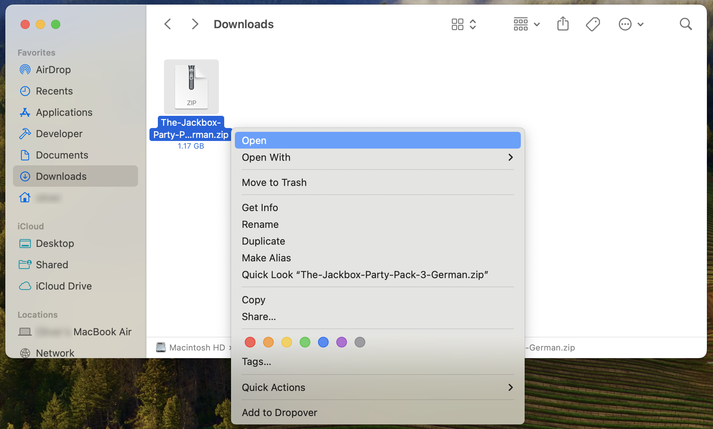
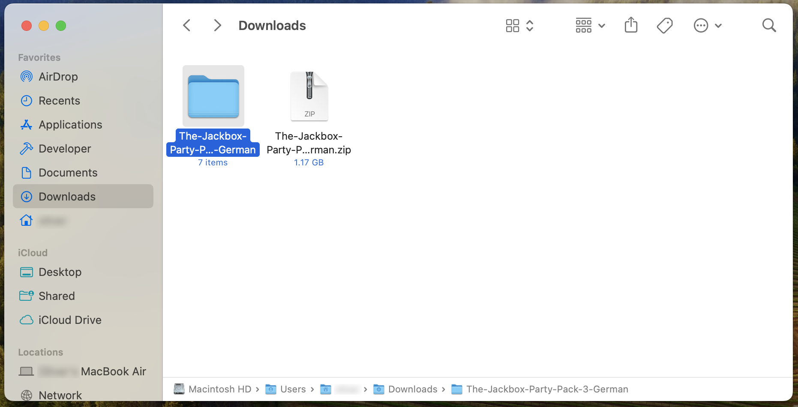
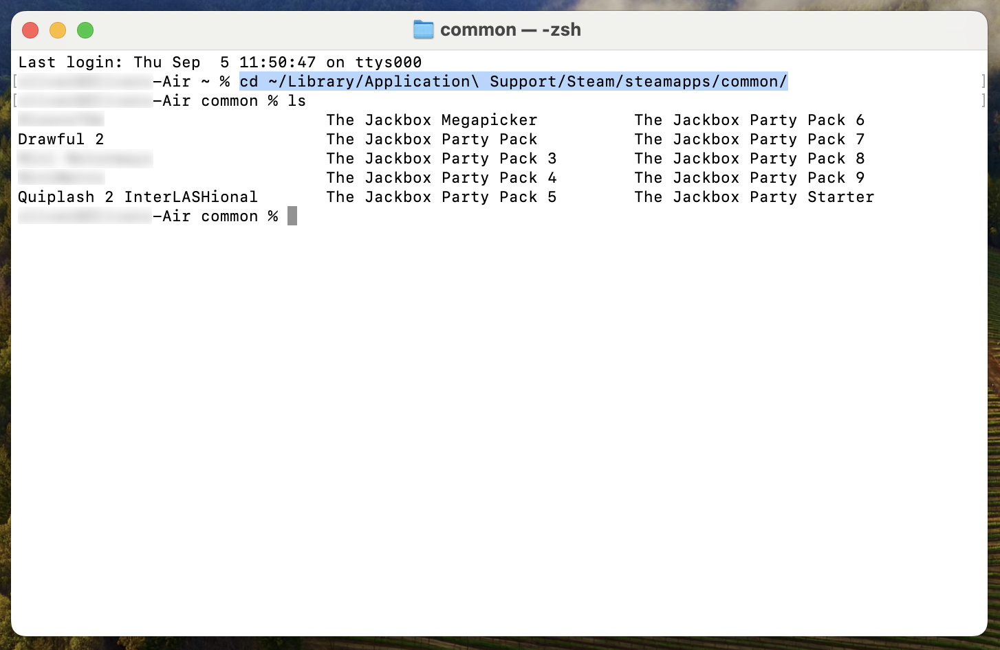
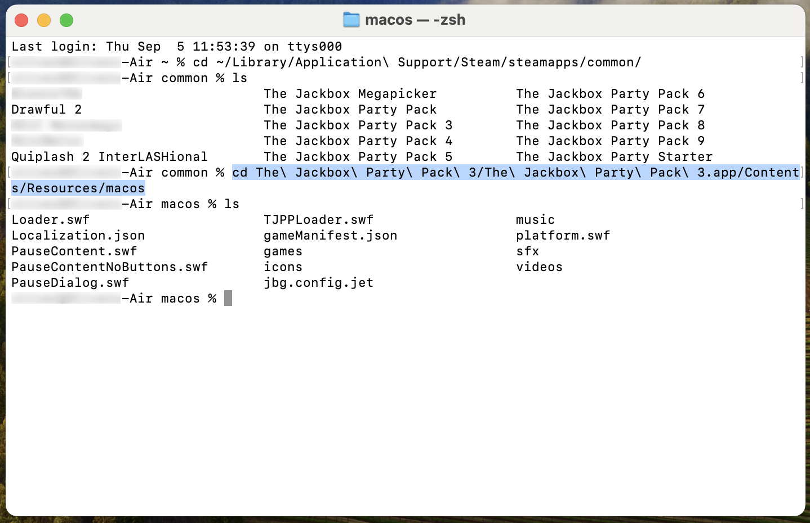
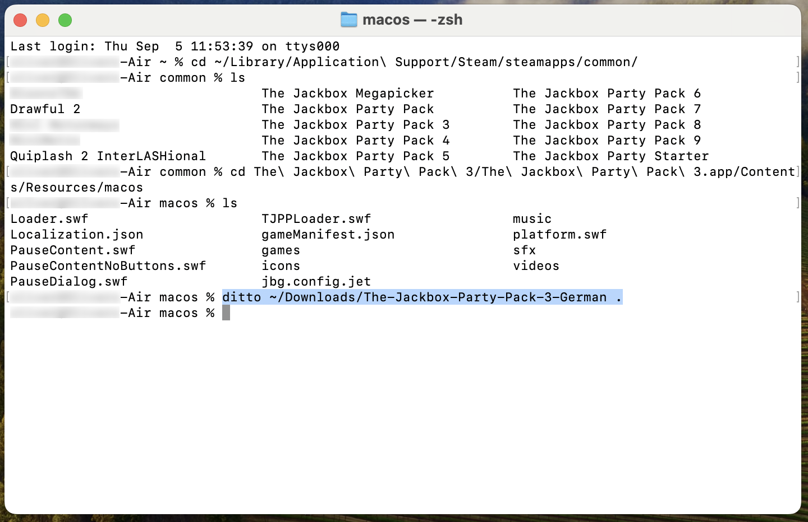

# Installation auf macOS

In diesem Artikel erklären wir dir Schritt für Schritt, wie du die Deutsch-Patches manuell auf macOS-Systemen installieren kannst.

!!! tip "Installation mit Utility"
    Du kannst die Patches auch mit [Jackbox Utility für macOS](JackboxUtility.md#macos) installieren.

Beende das Spiel vor der Installation und verwende den Patch für dein Betriebssystem und deinen Store.

!!! warning ""
    Bitte befolge diese Anleitung ganz genau und überspringe keinen Schritt. Andernfalls kann es zu Fehlern wie Blackscreens in den Spielen kommen.

## :blue_book: Anleitung

Du kannst den Patch mit **WinZip** oder über das **Terminal** (Kommandozeile) installieren.

Lies die Schritte deiner gewählten Methode vollständig, bevor du beginnst. Wenn du dir bei den Dateipfaden unsicher bist, [frage bei uns nach](../Wissenswertes/BugReport.md).

=== "WinZip"
    1. Lade dir [**WinZip**](https://www.winzip.com/en/mac/) herunter und installiere das Programm.
    2. Lade dir die ZIP-Datei für das entsprechende Party Pack [**hier**](https://jackboxpatch.de/downloads) herunter.
    3. Öffne in einem zweiten Fenster den Ordner mit deinem Spiel im Finder.

        !!! info "So findest du den Ordner über Steam"
            1. Rechtsklicke auf das Party Pack Spiel in deiner Steam-Bibliothek und klicke auf "Verwalten".
            2. Klicke dann auf "Lokale Dateien durchsuchen". Es öffnet sich der Dateipfad im Finder.

    4. Rechtsklick auf die App und "**Paketinhalt anzeigen**" auswählen.
    5. Dort in den Ordner `Contents/Resources/macos` navigieren, die ZIP-Datei vom Patch mit **WinZip** öffnen, und alle Dateien in den Ordner des Spieleverzeichnis via Drag and Drop ziehen.

    !!! tip "Video-Tutorial"
        Die spanische Jackbox-Community hat [hier](https://youtu.be/RTb0_aFtLLY) ein ausführliches Video hochgeladen, welches diese Installations-Methode genauer behandelt.

=== "Terminal"
    1. Lade dir die ZIP-Datei für das entsprechende Party Pack [**hier**](https://jackboxpatch.de/downloads) herunter und extrahiere es in den Downloads-Ordner. Stelle sicher, dass es in einem Ordner mit demselben Namen wie der Patch extrahiert wurde.
    
    
    2. Greife mit dem Terminal auf das Verzeichnis zu, in dem sich die Packs befinden.
    ```
    cd ~/Library/Application\ Support/Steam/steamapps/common/
    ```
    Mit dem "ls"-Befehl kannst du den Inhalt des Ordners anzeigen, in dem du dich gerade befindest.
    
    3. Navigiere von dort in den "macos/"-Ordner des zu patchenden Spiels. Das folgende Beispiel gilt für Party Pack 3; passe die Namen an dein Spiel an.
    ```
    cd "The Jackbox Party Pack 3/The Jackbox Party Pack 3.app/Contents/Resources/macos"
    ```
    
    4. Installiere die Patches mit dem `ditto` Befehl. Wenn die Dateien der Übersetzungen sich im "Downloads" Ordner befinden, muss folgender Befehl verwendet werden:
    ```
    ditto ~/Downloads/The-Jackbox-Party-Pack-3-German .
    ```
    
    **Wichtig:** Nicht den ZIP-Ordner auswählen. Der Punkt ist wichtig, da dieser den aktuellen Ordner als Ziel für den Kopier-Befehl festlegt. Der genaue Ordnername kann abhängig vom Spiel abweichen. 

    !!! tip "Video-Tutorial"
        Die spanische Jackbox-Community hat [hier](https://drive.google.com/file/d/1cqZ2mi9CKJwuc3pitR59f3jDASlKAvRF/view) ein ausführliches Video hochgeladen, welches diese Installations-Methode genauer behandelt.

!!! info "Mögliche Fehlerursachen"
    Falls das Spiel nach der Installation nicht mehr starten sollte, haben wir hier einige [**mögliche Fehlerursachen**](../Problembehebung/MacOSFehlermeldung.md) zusammengestellt.

## Installation prüfen

Starte das Spiel und prüfe, ob die angebotenen Inhalte auf Deutsch erscheinen. Auf dem Handy verwendest du [Jackbox.de](../Wissenswertes/JackboxDE.md).

- [Probleme unter macOS](../Problembehebung/MacOSFehlermeldung.md)
- [Patch aktualisieren](aktualisieren.md)
- [Patch entfernen / Spiel zurücksetzen](../Deinstallation/index.md)

Falls die Installation auf deinem Mac scheitert, [melde uns dein Mac-Modell und deine macOS-Version](../Wissenswertes/BugReport.md). Die Kompatibilität kann sich je nach Spiel und System unterscheiden.
